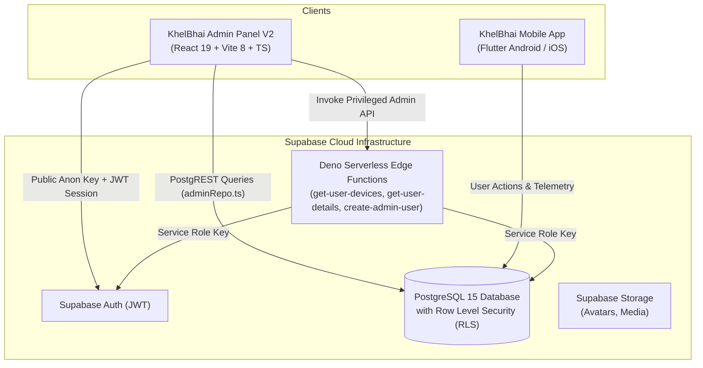

# KhelBhai Admin Panel — Control Center V2

[](package.json)
[](https://react.dev/)
[](https://www.typescriptlang.org/)
[](https://vitejs.dev/)
[](https://tailwindcss.com/)
[](https://supabase.com/)
[]()

The **KhelBhai Admin Panel** is an enterprise-grade, high-performance administrative control center built for platform governance, user lifecycle inspection, activity moderation, push communication, and remote system orchestration for **KhelBhai** sports community platform.

It interfaces seamlessly with **Supabase (PostgreSQL 15+)** with strict Row-Level Security (RLS) policies and coordinates in real-time with the **KhelBhai Mobile Application (Flutter)**.

---

## 📌 Release Highlights — Version 2.0.0 (Official Brand Design & Visual Assets)

This major release transforms the Admin Panel into the official **KhelBhai V2 Brand Design System**, matching the Flutter production mobile application visual identity and asset language:

### 1. 🎨 Official Brand Design Tokens & System
- Fully replaced legacy ActivityConnect navy/green branding with official KhelBhai visual identity:
  - **Primary Orange**: `#F46A35` (Interactive primary, badges, active states)
  - **Orange Hover**: `#DC5425`
  - **Warm Amber**: `#FFB45E` (Secondary highlights, gradients, alerts)
  - **Amber Hover**: `#EAA04C`
  - **Light Background**: `#FFF8F1` | **Light Surface**: `#FFFFFF` | **Light Border**: `#F0E4DA`
  - **Dark Background**: `#12141B` | **Dark Surface**: `#20232D` | **Dark Border**: `#2E3442`
  - **Primary Dark Text**: `#171D2A` | **Dark Primary Text**: `#FFF8F1` | **Muted Text**: `#697386` / `#9CA3AF`

### 2. 🌓 Complete Light & Dark Theme Engine
- Full support for **Light**, **Dark**, and **System** themes.
- Seamless automatic synchronization with OS `prefers-color-scheme`.
- Robust preference persistence under `'khelbhai_admin_theme'` in `localStorage`.
- Branded theme toggles integrated into both sidebar and top navigation bar.

### 3. 🏅 Official Vector Assets & 3D Sports Illustration Engine
- Official vector `KhelBhaiLogo` with kinetic sports shield emblem, gradient fill, and brand typography.
- SVG favicon (`public/favicon.svg`) with warm orange-amber sports shield.
- Custom 3D vector sports illustration suite (`SportsIllustration.tsx`):
  - `login_hero`: Multi-sport 3D composition with cricket, football, basketball, and tennis equipment.
  - Contextual illustrated empty states: `empty_users`, `empty_activities`, `empty_devices`, `empty_notifications`, `empty_reports`, and `empty_general`.

### 4. 🧩 Branded Reusable Component Suite (`src/components/brand/`)
- **AdminSidebar**: Grouped navigation, active orange indicators, user profile pill, and embedded theme toggle.
- **AdminHeader**: Glassmorphic sticky header, live connection indicator, and quick actions.
- **AdminPageHeader**: Title, subtitle, badge counters, and action button slots.
- **AdminStatCard**: Elevated KPI metric cards with brand orange accents.
- **AdminDataTable**: Responsive data tables with sticky headers, pagination, skeleton loading, and empty state illustrations.
- **AdminSearchBar** & **AdminFilterBar**: Consistent search inputs with instant clear action and filter pills.
- **AdminStatusBadge**: High-contrast, WCAG-compliant status badges for users, devices, requests, and reports.
- **AdminFormField**: Form controls with error states and helper copy.
- **AdminModal**: Accessible glassmorphic modal dialogs with escape/backdrop dismissal.
- **AdminEmptyState** & **AdminLoadingSkeleton**: Consistent illustration-driven feedback states.
- **AdminErrorState**: Diagnostic error states with retry actions.

### 5. 🛡️ Preserved Telemetry, Profile & Device Fixes (Zero Regressions)
- **Multi-tier resilient device retrieval**: Seamlessly falls back across `get-user-devices` Edge Function -> `get_user_devices_for_admin` RPC -> direct PostgREST with RLS.
- **User profile completeness**: Reliable fallback to `auth.users` for missing emails/phones on older accounts.
- **Diagnostic logging**: Structured latency, request ID, and error telemetry without exposing secrets or tokens.

---

## 🏗️ System Architecture



---

## 🎯 Admin Modules & Capabilities

The KhelBhai Admin Panel provides 11 dedicated functional modules:

| # | Module | Route | Capabilities |
|---|---|---|---|
| 1 | **Dashboard** | `/` | KhelBhai Control Center overview with real-time KPI cards, registration stream, and device breakdown. |
| 2 | **User Directory** | `/users` | High-speed RPC search by name/email, city/status filtering, profile inspection, status mutations. |
| 3 | **Sports Activities** | `/requests` | Review published sports posts, location coordinates, player slots, participation rules, and cancellation. |
| 4 | **Join Requests** | `/join-requests` | Audit and supervise join applications sent from players to host organizers. |
| 5 | **Sports Categories** | `/categories` | Manage sports taxonomies (Badminton, Cricket, Football, etc.), display ordering, and visibility toggles. |
| 6 | **City Operations** | `/cities` | Geographical coverage management, state assignments, pin code mappings, and active/inactive switches. |
| 7 | **Safety & Reports** | `/reports` | Player report queue (harassment, spam, no-shows), resolution notes, and one-click account suspension. |
| 8 | **Device Telemetry** | `/devices` | Real-time hardware inventory: OS versions, device models, app build numbers, FCM push tokens, and last active heartbeats. |
| 9 | **Broadcast Center** | `/notifications` | Dispatch rich push notifications and in-app alerts to all users or filtered audience segments with delivery history logs. |
| 10 | **App Configuration** | `/app-settings` | Remote maintenance mode kill-switch, feature flags (chat, sports scheduling), and minimum version enforcement gates. |
| 11 | **Staff Roles & RBAC** | `/admin-roles` | Provision and audit internal admin accounts, assign roles (`super_admin`, `admin`, `moderator`). |

---

## 💻 Tech Stack & Dependencies

| Layer | Technologies |
|---|---|
| **Core Framework** | React 19 (`react` ^19.2, `react-dom` ^19.2) |
| **Build Tooling** | Vite 8 (`vite` ^8.2), TypeScript (~6.0) |
| **Routing** | React Router v7 (`react-router-dom` ^7.18) with `React.lazy()` chunking |
| **Styling & Design** | Tailwind CSS 3 (`tailwindcss` ^3.4), `tailwindcss-animate`, `clsx`, `tailwind-merge` |
| **Design System** | Custom KhelBhai V2 Tokens (CSS Custom Properties + Tailwind extension) |
| **UI Primitives** | Radix UI (Avatar, Dialog, Dropdown Menu, Label, Select, Slot) |
| **Icons** | Lucide React (`lucide-react` ^1.31) |
| **Database & Auth** | Supabase JavaScript Client (`@supabase/supabase-js` ^2.112) |
| **Linting & Code Quality** | ESLint 10, TypeScript-ESLint 8, React Hooks & Refresh Plugins |

---

## 📂 Directory Layout

```text
lastspot_backend/
├── .agents/                      # AI pair-programming rules & project context
│   ├── rules/                    # Architectural guidelines & graphify agent rules
│   └── workflows/                # Agent slash workflows (/graphify)
├── .github/                      # CI/CD automation
│   └── workflows/
│       ├── ci.yml                # Automated build & lint check
│       ├── deploy.yml            # Automated GitHub Pages release
│       └── deploy-functions.yml  # Supabase Edge Functions deployment
├── docs/                         # Comprehensive engineering documentation suite
│   ├── ADMIN_MODULES.md          # Functional specifications for all 11 modules
│   ├── ARCHITECTURE.md           # Architecture diagrams, data flow & security
│   ├── CHANGELOG.md              # Historical version changelog (v2.0.0)
│   ├── CODE_REVIEW.md            # Detailed code quality analysis
│   ├── DATABASE_SCHEMA.md        # PostgreSQL tables, RPCs & RLS policies
│   ├── DECISIONS.md              # Architectural Decision Records (ADRs)
│   ├── DEVELOPMENT_SOP.md        # Standard Operating Procedures & git guidelines
│   ├── PROJECT_CONTEXT.md        # Project overview and domain vocabulary
│   └── UI_UX_GUIDELINES.md       # Color tokens, typography & motion guidelines
├── public/                       # Static assets & SVG favicon
├── src/
│   ├── app/                      # Application core (ThemeProvider, AuthProvider, Router)
│   ├── components/               # UI components
│   │   ├── brand/                # KhelBhai V2 Brand UI System (Sidebar, Header, Table, etc.)
│   │   └── common/               # Layouts and shared alerts
│   ├── core/                     # Constants, UI strings, Supabase client
│   ├── features/                 # Modular feature domains (auth, users, requests, etc.)
│   └── lib/                      # Data repository layer (adminRepo.ts, devices.ts)
├── supabase/                     # Supabase Edge Functions & migrations
├── .env.example                  # Environment configuration template
├── .gitignore                    # Production git ignore specification
├── package.json                  # Project manifest (v2.0.0)
├── tailwind.config.js            # Tailwind theme tokens & KhelBhai brand colors
└── vite.config.ts                # Vite bundler configuration
```

---

## 🚀 Getting Started

### Prerequisites
- **Node.js**: `20.x` LTS or higher
- **npm**: `10.x` or higher

### Installation & Setup

1. **Clone the repository:**
   ```bash
   git clone https://github.com/SalmanNaghori/lastspot_backend.git
   cd lastspot_backend
   ```

2. **Install project dependencies:**
   ```bash
   npm install
   ```

3. **Configure Environment Variables:**
   Copy `.env.example` to `.env` and fill in your Supabase credentials:
   ```bash
   cp .env.example .env
   ```
   ```env
   VITE_SUPABASE_URL=https://<your-project-id>.supabase.co
   VITE_SUPABASE_ANON_KEY=<your-supabase-anon-key>
   ```

4. **Launch Local Development Server:**
   ```bash
   npm run dev
   ```
   Open your browser at `http://localhost:5173`.

---

## 🧪 Verification & Quality Assurance

Run the standard quality verification sequence:

```bash
# 1. Run static analysis & ESLint verification (0 errors required)
npm run lint

# 2. Verify TypeScript types and execute production bundle build
npm run build

# 3. Preview local production build bundle
npm run preview
```

---

## 🚢 Deployment & CI/CD

- **GitHub Pages Deployment:** Pushes to `main` automatically trigger [`.github/workflows/deploy.yml`](.github/workflows/deploy.yml), building the production distribution and publishing the SPA to GitHub Pages.
- **Edge Functions Deployment:** Changes to `supabase/functions/` are deployed automatically using [`.github/workflows/deploy-functions.yml`](.github/workflows/deploy-functions.yml).

---

## 🧠 Codebase Intelligence & Knowledge Graph (Graphify)

The project includes built-in knowledge graph tooling using **Graphify** to convert the entire codebase AST into a queryable knowledge graph with community clustering, visual architecture exploration, and GraphRAG querying.

> [!NOTE]
> All generated knowledge graph files and caches (`graphify-out/`, `.graphify*`) are local-only and excluded from version control via `.gitignore` to keep git commits and GitHub clean.

### 1. Generating or Updating the Graph
```bash
# Full local AST extraction (100% deterministic, 0 API token cost):
graphify extract . --code-only

# Or within AI coding assistants:
/graphify .

# Incremental update after modifying code:
graphify update .
```

### 2. Exploring Visualizations in the Browser
Once generated, the following standalone HTML files can be opened directly without running a web server:
- **Interactive Force Graph:** `graphify-out/graph.html` (interactive zoom, pan, search, community clustering)
  ```powershell
  Start-Process graphify-out\graph.html
  ```
- **Call-Flow Architecture:** `graphify-out/lastspot_backend-1-callflow.html` (interactive Mermaid diagrams & call tables)
  ```powershell
  Start-Process graphify-out\lastspot_backend-1-callflow.html
  ```
- **Collapsible Symbol Hierarchy:** `graphify-out/GRAPH_TREE.html` (D3 collapsible directory & symbol tree)
  ```powershell
  Start-Process graphify-out\GRAPH_TREE.html
  ```
- **Architecture Report:** View `graphify-out/GRAPH_REPORT.md` in markdown preview for metrics, God nodes, and cohesion scores.

### 3. Querying from the Terminal
```bash
# Search neighbors and context around a symbol or concept:
graphify query "AuthContext"

# Find the shortest dependency path between components:
graphify path "LoginPage.tsx" "src/core/supabase/client.ts::supabase"

# Explain a specific node and its inbound/outbound connections:
graphify explain "ComprehensiveAdminRepository"
```

---

## 📖 Complete Documentation Suite

For detailed technical references, refer to the guides in [`docs/`](docs):

| Document | Focus |
|---|---|
| [**PROJECT_CONTEXT.md**](docs/PROJECT_CONTEXT.md) | Platform mission, core entity taxonomy, and feature status. |
| [**ARCHITECTURE.md**](docs/ARCHITECTURE.md) | Component architecture, state flow, security, and edge functions. |
| [**ADMIN_MODULES.md**](docs/ADMIN_MODULES.md) | Deep-dive functional specifications for each admin screen. |
| [**DATABASE_SCHEMA.md**](docs/DATABASE_SCHEMA.md) | Database tables, indexes, RPCs, and RLS security policies. |
| [**UI_UX_GUIDELINES.md**](docs/UI_UX_GUIDELINES.md) | Design tokens, color palette, dark mode, typography, and motion. |
| [**DEVELOPMENT_SOP.md**](docs/DEVELOPMENT_SOP.md) | Git conventions, branching strategy, and pre-commit checklist. |
| [**CODE_REVIEW.md**](docs/CODE_REVIEW.md) | Audit findings, resolution history, and code health ratings. |
| [**CHANGELOG.md**](docs/CHANGELOG.md) | Full version history and detailed modification records. |
| [**DECISIONS.md**](docs/DECISIONS.md) | Architectural Decision Records (ADRs) explaining technical choices. |

---

## 📄 License & Attribution

This project is proprietary and maintained for **KhelBhai**. All rights reserved.