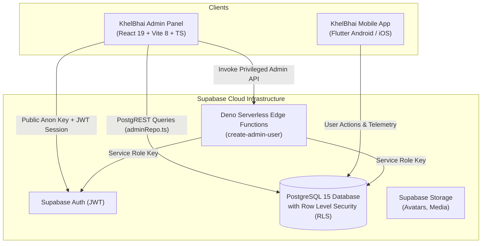

# KhelBhai Admin Panel — Control Center

[](package.json)
[](https://react.dev/)
[](https://www.typescriptlang.org/)
[](https://vitejs.dev/)
[](https://tailwindcss.com/)
[](https://supabase.com/)
[]()

The **KhelBhai Admin Panel** is an enterprise-grade, high-performance administrative control center built for complete platform governance, user lifecycle inspection, activity moderation, push communication, and remote system orchestration for **KhelBhai** (formerly *LastSpot / ActivityConnect*).

It interfaces seamlessly with **Supabase (PostgreSQL 15+)** with strict Row-Level Security (RLS) policies and coordinates in real-time with the **KhelBhai Mobile Application (Flutter)**.

---

## 📌 Release Highlights — Version 1.0.0

This release elevates the platform into a unified, secure, and production-ready administration suite:

### 1. 🎨 Complete KhelBhai Rebranding & Visual Identity
- Fully rebranded from **LastSpot / ActivityConnect** to **KhelBhai Admin Control Center**.
- Designed and integrated custom high-resolution SVG favicon (`public/favicon.svg`) featuring the KhelBhai emerald sports motion shield.
- Modernized desktop and mobile sidebars with sports activity styling, active state glow, and `ADMIN` badge indicators.
- Revamped Login, Forgot Password, and Password Reset screens with tailored sports community aesthetics.
- Centralized all user-facing copy into `src/core/constants/app_strings.ts`.

### 2. ⚡ Route-Level Code Splitting & Performance Optimization
- Transitioned monolithic page imports into dynamic `React.lazy()` chunks with suspense boundaries.
- **Main JavaScript bundle size reduced by 55%** (from 684 kB down to 309 kB), eliminating Vite bundle size warnings and enabling sub-second initial paint times.

### 3. 🛡️ Security, RBAC & Session Reliability
- Enforced two-tier Role-Based Access Control (**RBAC**): `super_admin`, `admin`, and `moderator`.
- Rejection of unprivileged accounts attempting login with automated feedback.
- Migrated session tokens to `khelbhai_admin_session` with backward-compatible fallbacks.
- Reliable logout cleanup purging cached tokens across both `localStorage` and `sessionStorage`.

### 4. 🐛 React 19 Compliance & Static Analysis Fixes
- Resolved React 19 compiler `react-hooks/set-state-in-effect` violations in `UserDetailsPage.tsx`.
- Standardized `useEffect` dependency arrays across user and device query hooks.
- Attained **0 ESLint errors** across the entire workspace.

### 5. 📚 Comprehensive Architecture & Engineering Documentation
- Authored 9 structured reference guides in [`docs/`](docs) covering architecture, database schema, module specs, UI/UX guidelines, code reviews, and standard operating procedures.
- Created persistent AI instructions in `.agents/rules/project_context.md`.

### 6. 🔧 Repository & Environment Hygiene
- Re-architected [`.gitignore`](.gitignore) with robust rules protecting secrets, build outputs, OS metadata, and editor files.
- Added standardized [`.env.example`](.env.example) template for seamless local onboarding.
- Verified automated GitHub Actions CI/CD workflows for building and deploying to GitHub Pages.

---

## 🏗️ System Architecture



---

## 🎯 Admin Modules & Capabilities

The KhelBhai Admin Panel provides 11 dedicated functional modules:

| # | Module | Route | Capabilities |
|---|---|---|---|
| 1 | **Dashboard** | `/` | Real-time platform KPI counters (Users, Activities, Devices, Reports), live registration stream, activity feed, and device breakdown. |
| 2 | **User Directory** | `/users` | High-speed RPC search by name/email, city/status filtering, profile inspection, status mutation (Active, Suspended, Banned, Soft-Deleted). |
| 3 | **Sports Activities** | `/requests` | Review published sports posts, location coordinates, player slots, participation rules, and cancellation/soft-deletion. |
| 4 | **Join Requests** | `/join-requests` | Audit and supervise join applications sent from players to host organizers with approval/rejection auditing. |
| 5 | **Sports Categories** | `/categories` | Manage sports taxonomies (Badminton, Cricket, Football, etc.), emoji symbols, display ordering, and visibility toggles. |
| 6 | **City Operations** | `/cities` | Geographical coverage management, state assignments, pin code mappings, and active/inactive switches. |
| 7 | **Safety & Reports** | `/reports` | Player report queue (harassment, spam, no-shows), evidence review, resolution notes, and one-click account suspension. |
| 8 | **Device Telemetry** | `/devices` | Real-time hardware inventory: OS versions, device models, app build numbers, FCM push tokens, and last active heartbeats. |
| 9 | **Broadcast Center** | `/notifications` | Dispatch rich push notifications and in-app alerts to all users or filtered audience segments with delivery history logs. |
| 10 | **App Configuration** | `/app-settings` | Remote maintenance mode kill-switch, feature flags (chat, carpooling, sports scheduling), and minimum version enforcement gates. |
| 11 | **Staff Roles & RBAC** | `/admin-roles` | Provision and audit internal admin accounts, assign roles (`super_admin`, `admin`, `moderator`) via secure Edge Functions. |

---

## 💻 Tech Stack & Dependencies

| Layer | Technologies |
|---|---|
| **Core Framework** | React 19 (`react` ^19.2, `react-dom` ^19.2) |
| **Build Tooling** | Vite 8 (`vite` ^8.2), TypeScript (~6.0) |
| **Routing** | React Router v7 (`react-router-dom` ^7.18) with `React.lazy()` |
| **Styling & Design** | Tailwind CSS 3 (`tailwindcss` ^3.4), `tailwindcss-animate`, `clsx`, `tailwind-merge` |
| **UI Primitives** | Radix UI (Avatar, Dialog, Dropdown Menu, Label, Select, Slot) |
| **Icons** | Lucide React (`lucide-react` ^1.31) |
| **Database & Auth** | Supabase JavaScript Client (`@supabase/supabase-js` ^2.112) |
| **Linting & Code Quality** | ESLint 10, TypeScript-ESLint 8, React Hooks & Refresh Plugins |

---

## 📂 Directory Layout

```text
lastspot_backend/
├── .agents/                      # AI pair-programming rules & project context
│   └── rules/
├── .github/                      # CI/CD automation
│   └── workflows/
│       ├── ci.yml                # Automated build & lint check
│       ├── deploy.yml            # Automated GitHub Pages release
│       └── deploy-functions.yml  # Supabase Edge Functions deployment
├── docs/                         # Comprehensive engineering documentation suite
│   ├── ADMIN_MODULES.md          # Functional specifications for all 11 modules
│   ├── ARCHITECTURE.md           # Architecture diagrams, data flow & security
│   ├── CHANGELOG.md              # Historical version changelog
│   ├── CODE_REVIEW.md            # Detailed code quality analysis
│   ├── DATABASE_SCHEMA.md        # PostgreSQL tables, RPCs & RLS policies
│   ├── DECISIONS.md              # Architectural Decision Records (ADRs)
│   ├── DEVELOPMENT_SOP.md        # Standard Operating Procedures & git guidelines
│   ├── PROJECT_CONTEXT.md        # Project overview and domain vocabulary
│   └── UI_UX_GUIDELINES.md       # Color tokens, typography & motion guidelines
├── public/                       # Static assets & SVG favicon
├── src/
│   ├── app/                      # Application core (Providers, Router, Lazy chunks)
│   ├── components/               # Common layouts, sidebars, navigation, Radix UI
│   ├── core/                     # Constants, UI strings, Supabase client
│   ├── features/                 # Modular feature domains (auth, users, requests, etc.)
│   └── lib/                      # Data repository layer (adminRepo.ts, utils.ts)
├── supabase/                     # Supabase Edge Functions & migrations
├── .env.example                  # Environment configuration template
├── .gitignore                    # Production git ignore specification
├── package.json                  # Project manifest (v1.0.0)
├── tailwind.config.js            # Tailwind theme tokens & extensions
└── vite.config.ts                # Vite bundler configuration
```

---

## 🚀 Getting Started

### Prerequisites
- **Node.js**: `20.x` LTS or higher
- **npm**: `10.x` or higher

### Installation & Setup

1. **Clone the repository:**
   ```bash
   git clone https://github.com/SalmanNaghori/lastspot_backend.git
   cd lastspot_backend
   ```

2. **Install project dependencies:**
   ```bash
   npm install
   ```

3. **Configure Environment Variables:**
   Copy `.env.example` to `.env` and fill in your Supabase credentials:
   ```bash
   cp .env.example .env
   ```
   ```env
   VITE_SUPABASE_URL=https://<your-project-id>.supabase.co
   VITE_SUPABASE_ANON_KEY=<your-supabase-anon-key>
   ```

4. **Launch Local Development Server:**
   ```bash
   npm run dev
   ```
   Open your browser at `http://localhost:5173`.

---

## 🧪 Verification & Quality Assurance

Before committing or opening pull requests, run the standard quality verification sequence:

```bash
# 1. Run static analysis & ESLint verification (0 errors required)
npm run lint

# 2. Verify TypeScript types and execute production bundle build
npm run build

# 3. Preview local production build bundle
npm run preview
```

---

## 🚢 Deployment & CI/CD

- **GitHub Pages Deployment:** Pushing changes to the `main` branch automatically triggers [`.github/workflows/deploy.yml`](.github/workflows/deploy.yml), compiling the production distribution and publishing the SPA to GitHub Pages.
- **Edge Functions Deployment:** Changes to `supabase/functions/` are deployed automatically using [`.github/workflows/deploy-functions.yml`](.github/workflows/deploy-functions.yml).

---

## 📖 Complete Documentation Suite

For detailed technical references, refer to the guides in [`docs/`](docs):

| Document | Focus |
|---|---|
| [**PROJECT_CONTEXT.md**](docs/PROJECT_CONTEXT.md) | Platform mission, core entity taxonomy, and feature status. |
| [**ARCHITECTURE.md**](docs/ARCHITECTURE.md) | Component architecture, state flow, security, and edge functions. |
| [**ADMIN_MODULES.md**](docs/ADMIN_MODULES.md) | Deep-dive functional specifications for each admin screen. |
| [**DATABASE_SCHEMA.md**](docs/DATABASE_SCHEMA.md) | Database tables, indexes, RPCs, and RLS security policies. |
| [**UI_UX_GUIDELINES.md**](docs/UI_UX_GUIDELINES.md) | Design tokens, color palette, dark mode, typography, and motion. |
| [**DEVELOPMENT_SOP.md**](docs/DEVELOPMENT_SOP.md) | Git conventions, branching strategy, and pre-commit checklist. |
| [**CODE_REVIEW.md**](docs/CODE_REVIEW.md) | Audit findings, resolution history, and code health ratings. |
| [**CHANGELOG.md**](docs/CHANGELOG.md) | Full version history and detailed modification records. |
| [**DECISIONS.md**](docs/DECISIONS.md) | Architectural Decision Records (ADRs) explaining technical choices. |

---

## 📄 License & Attribution

This project is proprietary and maintained for **KhelBhai**. All rights reserved.