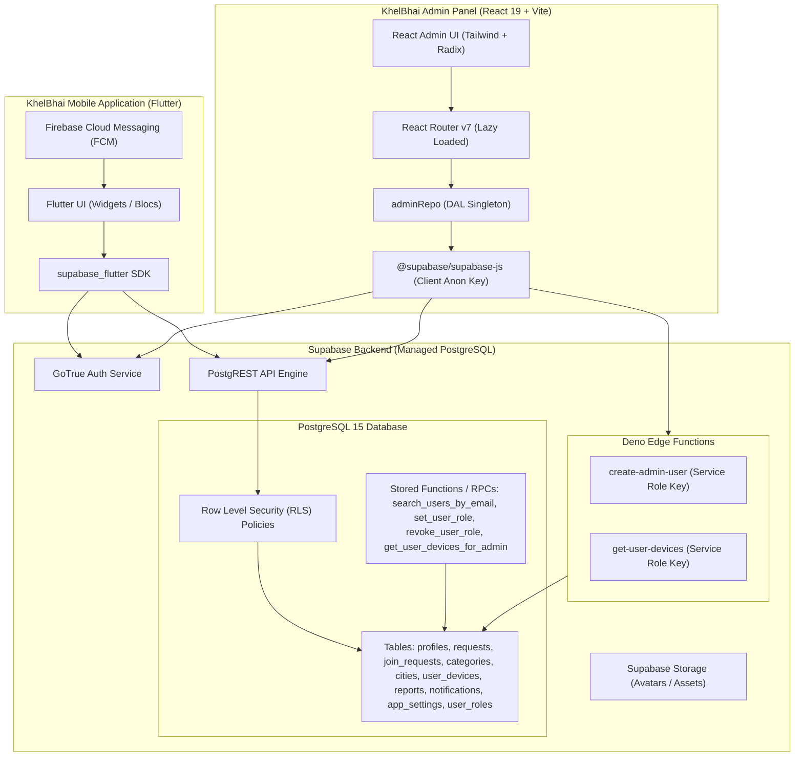
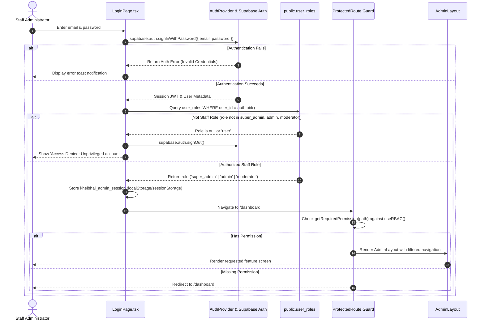
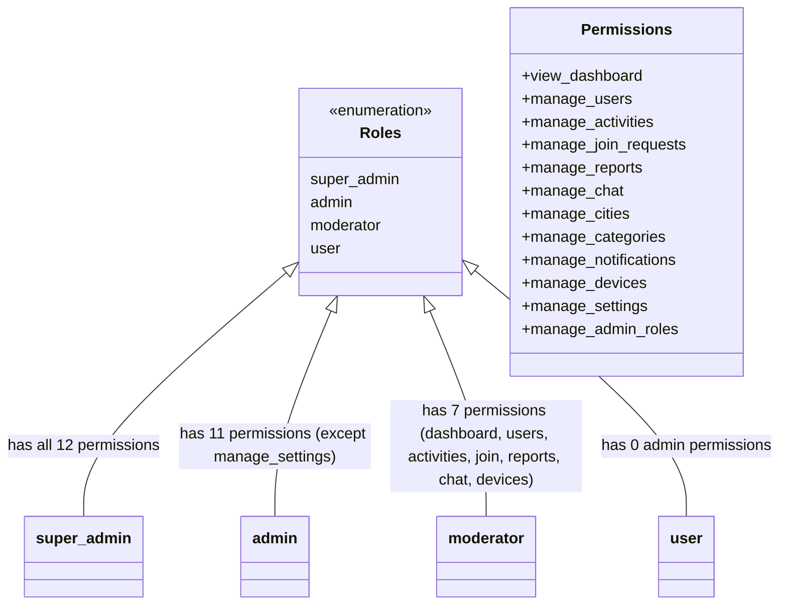
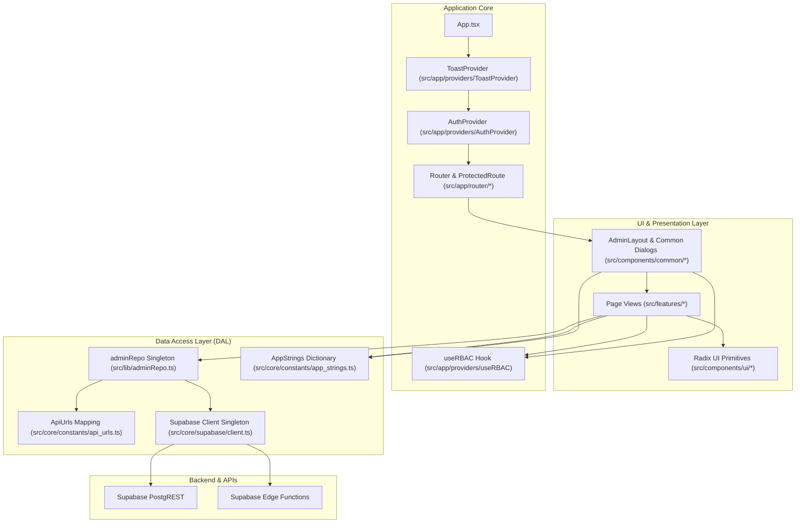
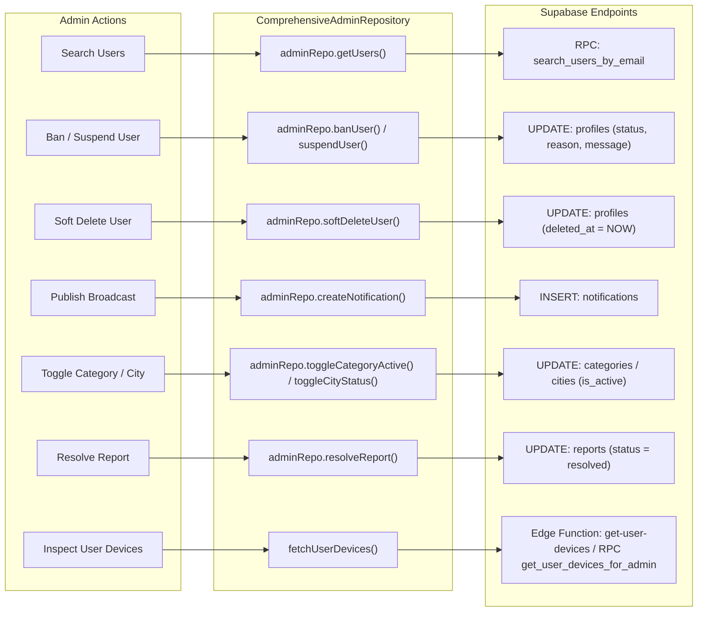
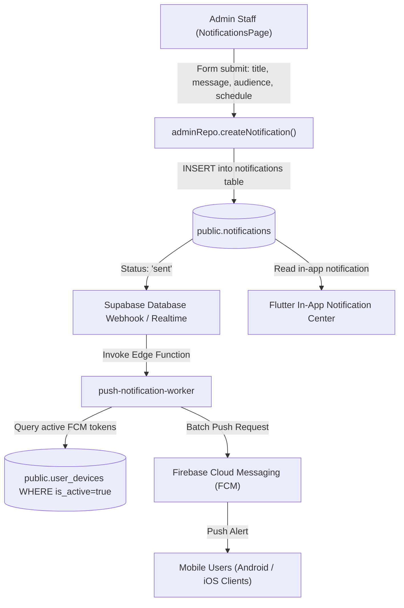
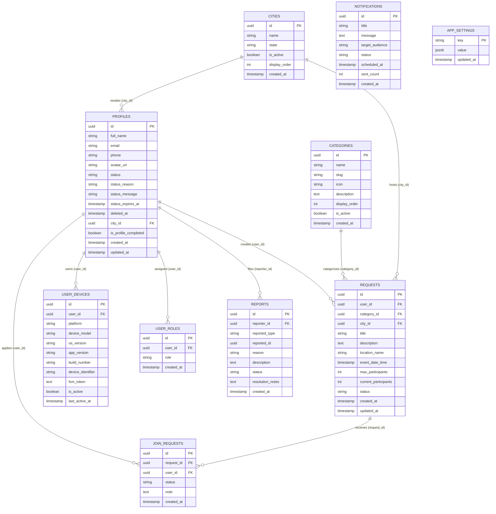

# KhelBhai Admin Panel — Architecture & System Design

This document details the architectural design, component relationships, data flow pipelines, and integration boundaries between the **KhelBhai Mobile App (Flutter)**, **Supabase Backend**, and **KhelBhai Admin Panel (React)**.

---

## 1. High-Level Ecosystem Architecture

---

## 2. Authentication & Authorization Pipeline

The Admin Panel enforces a two-tier authentication and verification model:
1. Standard Supabase credential verification (`supabase.auth.signInWithPassword`).
2. Immediate role verification against the `user_roles` database table. Accounts lacking `super_admin`, `admin`, or `moderator` privileges are immediately ejected and signed out.

---

## 3. RBAC Permissions Matrix

---

## 4. Module Dependency Graph

The codebase cleanly decouples UI views, business controllers, and data services:

---

## 5. Supabase Data Flow & PostgREST Operations

---

## 6. Notification Dispatch Architecture

Broadcasts dispatched by admins flow into PostgreSQL, triggering background notifications:

---

## 7. Shared Database Entities & Consistency Map

